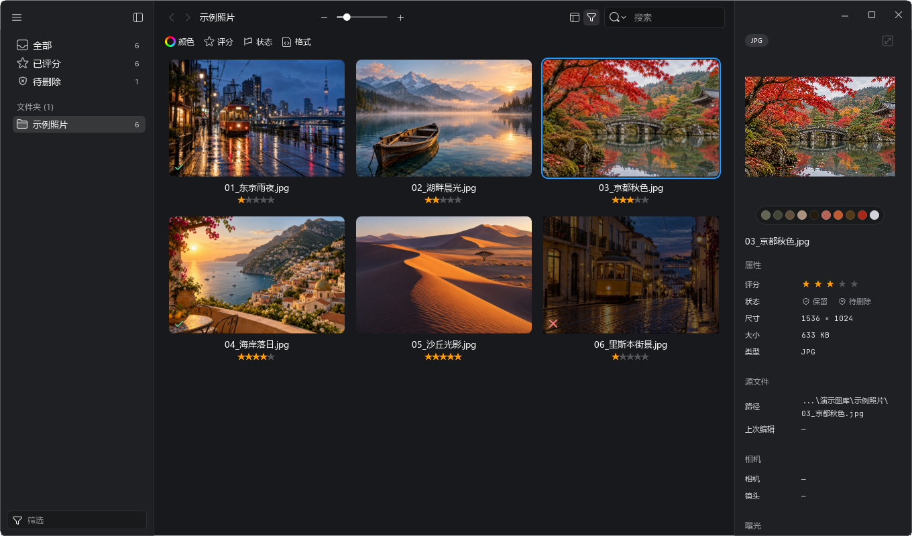
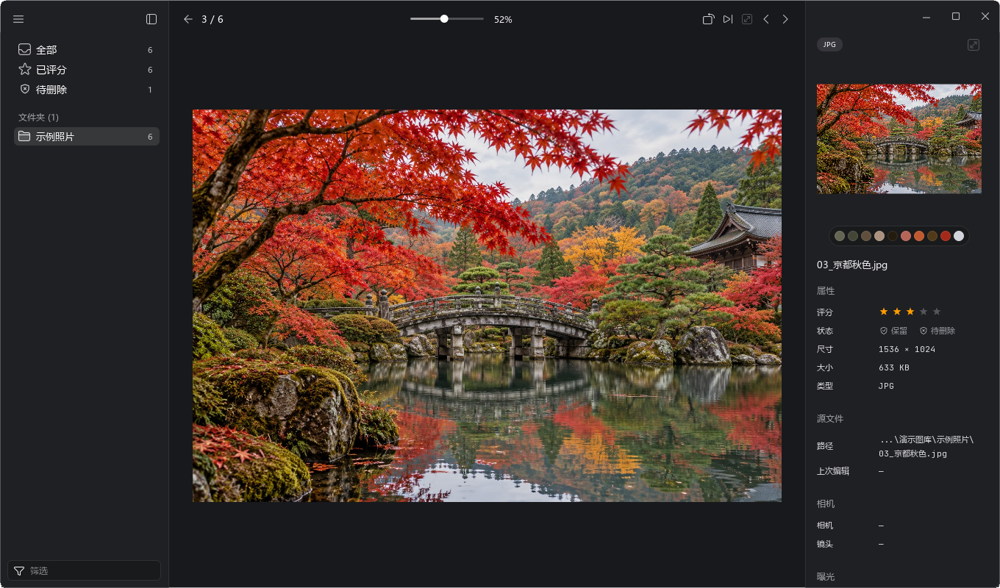

<div align="center">

<br />
<strong>PickLight</strong>

[简体中文](README.md) | [English](docs/README_EN.md)


[](LICENSE)


</div>

---

## 📷 项目介绍

PickLight 用于浏览、筛选和标记照片，支持同名 JPG 与 RAW 自动配对。导入时不移动原始文件，可关联已有照片目录并同步来源变化。

- 网格、瀑布流与选片模式，支持缩放、旋转和 JPG / RAW 切换
- 星级评分、保留与待删除标记，支持批量操作及组合筛选
- 文件夹树、快速访问、多选和框选，以及可自定义的主题与快捷键
- 全屏浏览、黑白预览和可按 `Ctrl + 滚轮` 调整大小的瀑布流

### 工作区



### 选片模式



### 文件处理

导入不会移动原始照片。JPG 评分写入内嵌 XMP，原生 RAW 评分写入同名 `.xmp` 文件，DNG 评分写入内嵌元数据；保留和待删除标记保存在本机。删除软件文件夹仅移除软件记录，“删除文件”会在确认后将原始照片及关联 XMP 移入 Windows 系统回收站。RAW 兼容范围取决于 LibRaw、相机型号和文件压缩方式。

## 🚀 快速开始

### 下载与运行

在 [Releases](https://github.com/mio-1/PickLight/releases) 下载对应版本：

- `PickLight-版本号-Setup.exe`：安装版，提供开始菜单快捷方式和卸载入口
- `PickLight-版本号-win-x64.zip`：便携版，解压后运行 `PickLight.exe`

### 从源码运行

需要以下环境：

- Windows
- Python 3.11 或更高版本
- Node.js / npm，用于安装 ExifTool

在项目根目录执行：

```powershell
python -m venv .venv
.\.venv\Scripts\python.exe -m pip install -e .
powershell -ExecutionPolicy Bypass -File .\tools\setup-exiftool.ps1
.\.venv\Scripts\python.exe -m picklight.app
```

### 选片流程

1. 导入照片目录，或将现有目录关联到软件文件夹
2. 双击照片进入选片模式，使用方向键切换照片，按 `R` 切换 JPG / RAW
3. 按 `1`–`5` 评分、`P` 标记保留、`X` 标记待删除，再按评分和标记筛选

快捷键可在偏好设置中修改。

### 文件夹与自动导入

左栏可展开文件夹树，并将常用文件夹添加到快速访问。顶部的切换文件夹入口支持搜索已关联文件夹。在“偏好设置 → 自动导入”开启监控后，关联目录中新出现的照片及子文件夹内的照片会自动纳入原关联文件夹；不会为子文件夹新建左栏项目，也不会移动原始文件。关闭期间新增的照片会在重新开启后补入。

### 全屏浏览

选中照片后，点击预览区或预览工具栏的“全屏浏览”按钮，可在当前软件窗口内放大浏览，并保留标题栏、窗口大小和位置。进入全屏浏览时照片会按比例完整适配画布，不会超出画布；底部保留可直接切图的缩略图条。按 `Esc` 或点击左上角返回按钮恢复原视图。预览工具栏中“全屏浏览”左侧的“适应大小”按钮可恢复画布居中。照片放大到超出画布时，右下角显示当前位置小窗。`F11` 单独切换系统全屏。

### 瀑布流

瀑布流缩略图可缩至更小尺寸，显示更多列。在照片网格上按住 `Ctrl` 滚动滚轮，可调整缩略图大小。

### 开发与构建

运行测试：

```powershell
.\.venv\Scripts\python.exe tools\run_tests.py
```

构建预览版：

```powershell
.\.venv\Scripts\python.exe -m pip install pyinstaller
.\tools\build.ps1 -Preview
```

构建结果位于 `dist\Preview\PickLight`。分发时保留完整目录。

## 📄 许可证

本项目采用 MIT 许可证 - 查看 [LICENSE](LICENSE) 文件了解详情。
