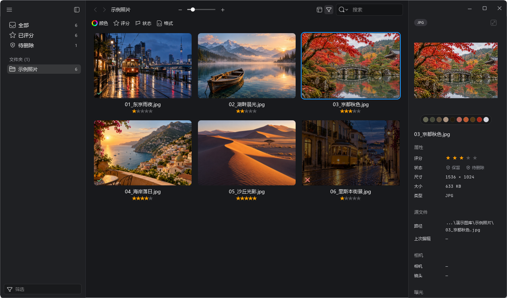
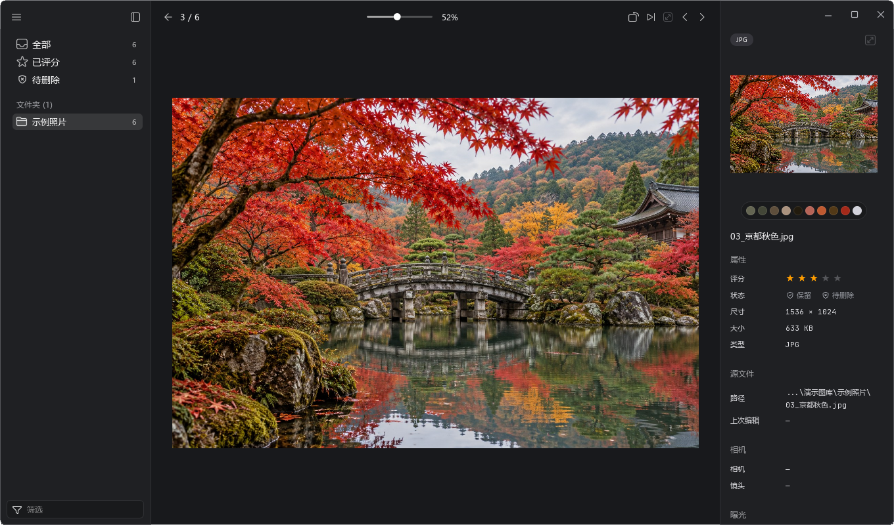

<div align="center">

<br />
<strong>PickLight</strong>

[简体中文](../README.md) | [English](README_EN.md)


[](../LICENSE)


</div>

---

## 📷 Introduction

PickLight helps you browse, filter, and mark photos, and automatically pairs JPG and RAW files with matching names. Importing does not move originals; you can link existing photo directories and sync source-file changes.

- Grid, masonry, and culling mode with zoom, rotation, and JPG / RAW switching
- Star ratings, keep and pending-deletion marks, batch operations, and combined filters
- Folder management, multiple and drag selection, customizable themes and shortcuts

### Workspace



### Culling mode



### File handling

Importing does not move original photos. JPG ratings are written to embedded XMP, native RAW ratings to a matching `.xmp` sidecar, and DNG ratings to embedded metadata; keep and pending-deletion marks are stored locally. Deleting an app folder only removes its PickLight record. **Delete File** moves the original photo and associated XMP to the Windows Recycle Bin after confirmation. RAW support depends on LibRaw, the camera model, and file compression.

## 🚀 Quick start

### Download and run

Download a build from [Releases](https://github.com/mio-1/PickLight/releases):

- `PickLight-VERSION-Setup.exe`: installer with a Start menu shortcut and uninstall entry
- `PickLight-VERSION-win-x64.zip`: portable build; extract it and run `PickLight.exe`

### Run from source

Requires:

- Windows
- Python 3.11 or later
- Node.js / npm to install ExifTool

Run from the project root:

```powershell
python -m venv .venv
.\.venv\Scripts\python.exe -m pip install -e .
powershell -ExecutionPolicy Bypass -File .\tools\setup-exiftool.ps1
.\.venv\Scripts\python.exe -m picklight.app
```

### Culling workflow

1. Import a photo directory or link an existing directory to an app folder.
2. Double-click a photo to enter culling mode. Use the arrow keys to change photos and `R` to switch JPG / RAW.
3. Press `1`–`5` to rate, `P` to keep, or `X` to mark pending deletion, then filter by rating or mark.

Shortcuts can be changed in Preferences.

### Development and build

Run tests:

```powershell
.\.venv\Scripts\python.exe tools\run_tests.py
```

Build a preview release:

```powershell
.\.venv\Scripts\python.exe -m pip install pyinstaller
.\tools\build.ps1 -Preview
```

The output is in `dist\Preview\PickLight`. Keep the entire directory when distributing it.

## 📄 License

This project is licensed under MIT - see the [LICENSE](../LICENSE) file for details.
